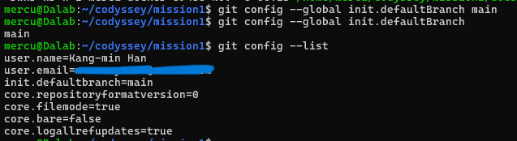

# Development Workstation 구축 및 Docker 실습

## 1. 프로젝트 개요

Windows 11 환경에서 WSL2 Ubuntu를 설치하고 터미널, Docker, Git/GitHub로 **재현 가능한 개발 워크스테이션**을 구축한 실습이다.

- 터미널로 작업 디렉터리를 구성하고 파일·디렉터리 권한을 실습하였다.
- Docker를 점검한 뒤 컨테이너를 실행·관리하였다.
- NGINX 기반 커스텀 이미지를 Dockerfile로 직접 만들고 포트 매핑으로 접속을 확인하였다.
- 바인드 마운트로 "변경 반영"을, Docker 볼륨으로 "데이터 영속성"을 검증하였다.
- Git 설정 후 GitHub 저장소와 VSCode를 연동하였다.

모든 결과는 명령어 + 출력(코드블록)과 스크린샷(`docs/images/`)으로 기록하였다.

## 2. 실행 환경

| 항목 | 내용 |
|---|---|
| 호스트 OS | Windows 11 Pro 25H2 (OS 빌드 26200.9711) |
| Linux 환경 | WSL2 + Ubuntu 26.04.1 LTS |
| Shell | bash |
| Terminal | Ubuntu(WSL) 터미널, Windows PowerShell |
| 작업 디렉터리 | `/home/mercu/codyssey/mission1` |
| 컨테이너 환경 | Docker Desktop (WSL2 backend) |
| Docker | 29.5.3 (Client / Server) |
| Docker Compose | v5.1.4 |
| Git | 2.53.0 (Ubuntu) / 2.54.0.windows.1 (Windows) |
| 웹 서버 베이스 이미지 | `nginx:alpine` |
| 브라우저 | Windows Chrome |

```bash
$ cat /etc/os-release
PRETTY_NAME="Ubuntu 26.04.1 LTS"
VERSION_ID="26.04"
VERSION="26.04.1 LTS (Resolute Raccoon)"
...

$ docker --version
Docker version 29.5.3, build d1c06ef

$ git --version
git version 2.53.0
```


## 3. 수행 체크리스트

- [x] 터미널 기본 조작 (위치 확인, 숨김 파일 목록, 이동, 생성, 복사, 이동/이름변경, 삭제, 내용 확인, 빈 파일 생성)
- [x] 권한 변경 실습 (파일 1개, 디렉터리 1개 / 변경 전·후 비교)
- [x] Docker 설치 점검 (`docker --version`, `docker info`)
- [x] Docker 기본 운영 (`images`, `ps`, `ps -a`, `logs`, `stats`)
- [x] hello-world 실행
- [x] ubuntu 컨테이너 내부 진입 및 명령 실행
- [x] exec / 종료 동작 차이 관찰
- [x] Dockerfile 기반 커스텀 이미지 빌드·실행
- [x] 포트 매핑 접속 (8080, 8081 / curl + 브라우저)
- [x] 바인드 마운트 변경 반영 (8082)
- [x] Docker 볼륨 영속성 검증
- [x] Git 사용자 정보 및 기본 브랜치 설정
- [ ] GitHub 저장소 연동 및 push
- [ ] VSCode GitHub 로그인 및 연동
- [x] 트러블슈팅 2건

## 4. 검증 방법 요약

| 검증 항목 | 사용 명령 | 확인 기준 | 결과 위치 |
|---|---|---|---|
| 터미널 조작 | `pwd`, `ls -la`, `mkdir`, `touch`, `cp`, `mv`, `rm`, `cat` | 파일/디렉터리 생성·변경 결과가 목록에 반영 | [5장](#5-터미널-조작-로그) |
| 권한 | `chmod`, `ls -l`, `ls -ld` | 권한 문자열이 변경 전·후로 달라짐 | [6장](#6-파일-및-디렉터리-권한-실습) |
| Docker 점검 | `docker --version`, `docker info` | Server 정보 정상 출력 | [7.1](#71-docker-설치-점검) |
| 컨테이너 운영 | `run`, `ps -a`, `exec`, `stop`, `logs`, `stats` | 상태(Up/Exited)와 출력 확인 | [7장](#7-docker-기본-운영-및-컨테이너-실습) |
| 커스텀 이미지 | `docker build`, `docker images` | `codyssey-web:1.0` 생성 | [8장](#8-dockerfile-기반-커스텀-이미지) |
| 포트 매핑 | `docker run -p`, `curl` | 8080/8081 접속 시 HTML 응답 | [8.4~8.5](#84-포트-매핑-8080) |
| 바인드 마운트 | `docker run -v <호스트경로>:...`, `curl` | 호스트 수정이 재빌드 없이 반영 | [9장](#9-바인드-마운트-실습) |
| 볼륨 영속성 | `docker volume create`, `docker rm`, `cat` | 컨테이너 삭제 후에도 데이터 유지 | [10장](#10-docker-볼륨-영속성-실습) |
| Git/GitHub | `git config --list`, `git remote -v`, `git push` | 설정값·원격 저장소 연동 확인 | [11장](#11-git-설정-및-github-연동) |

## 5. 터미널 조작 로그

### 5.1 작업 디렉터리 생성 및 구조

```bash
$ mkdir -p ~/codyssey/mission1
$ cd ~/codyssey/mission1
$ mkdir -p site docs/images practice
$ touch README.md Dockerfile
$ touch site/index.html
$ ls -la
total 20
drwxr-xr-x 5 mercu mercu 4096 Nov  4 01:52 .
drwxr-xr-x 3 mercu mercu 4096 Nov  4 01:47 ..
-rw-r--r-- 1 mercu mercu    0 Nov  4 01:52 Dockerfile
-rw-r--r-- 1 mercu mercu    0 Nov  4 01:52 README.md
drwxr-xr-x 3 mercu mercu 4096 Nov  4 01:52 docs
drwxr-xr-x 2 mercu mercu 4096 Nov  4 01:52 practice
drwxr-xr-x 2 mercu mercu 4096 Nov  4 01:52 site
```

```text
mission1/
├── README.md
├── Dockerfile
├── site/
│   └── index.html      # 웹 서버가 제공할 HTML
├── docs/
│   └── images/         # 실습 증거 스크린샷
└── practice/           # 터미널·권한 실습용
```


### 5.2 파일 및 디렉터리 관리

```bash
$ cd practice
$ pwd
/home/mercu/codyssey/mission1/practice

$ mkdir test_dir                 # 디렉터리 생성
$ touch empty.txt                # 빈 파일 생성
$ ls -l empty.txt
-rw-r--r-- 1 mercu mercu 0 Nov  4 01:53 empty.txt

$ echo "hello" > a.txt           # 내용이 있는 파일 생성
$ cat a.txt                      # 파일 내용 확인
hello

$ cp a.txt b.txt                 # 복사
$ mv b.txt test_dir/c.txt        # 이동 + 이름 변경
$ ls -l test_dir
-rw-r--r-- 1 mercu mercu 6 Nov  4 01:54 c.txt
$ cat test_dir/c.txt
hello

$ cd test_dir && pwd             # 이동
/home/mercu/codyssey/mission1/practice/test_dir
$ cd ..
$ rm test_dir/c.txt              # 삭제
$ ls -la test_dir
total 8
drwxr-xr-x 2 mercu mercu 4096 Nov  4 01:55 .
drwxr-xr-x 3 mercu mercu 4096 Nov  4 01:54 ..
```

| 명령어 | 기능 |
|---|---|
| `pwd` | 현재 위치 확인 |
| `ls -la` | 숨김 파일 포함 상세 목록 |
| `cd` | 디렉터리 이동 |
| `mkdir` / `mkdir -p` | 디렉터리 생성 / 상위 경로까지 한 번에 생성 |
| `touch` | 빈 파일 생성 |
| `cat` | 파일 내용 확인 |
| `cp` | 복사 |
| `mv` | 이동 및 이름 변경 |
| `rm` / `rmdir` | 파일 삭제 / 빈 디렉터리 삭제 |


### 5.3 절대 경로와 상대 경로

- **절대 경로**: 루트 `/`부터 시작하는 전체 경로. 현재 위치와 관계없이 항상 같은 곳을 가리킨다.
- **상대 경로**: 현재 위치를 기준으로 한 경로. `.`은 현재 디렉터리, `..`은 상위 디렉터리, `~`은 홈 디렉터리를 뜻한다.

```bash
$ cd /home/mercu/codyssey/mission1/practice   # 절대 경로
$ pwd
/home/mercu/codyssey/mission1/practice
$ cd ..                                       # 상대 경로 (상위로)
$ pwd
/home/mercu/codyssey/mission1
$ cd practice                                 # 상대 경로 (하위로)
$ pwd
/home/mercu/codyssey/mission1/practice
```


## 6. 파일 및 디렉터리 권한 실습

### 6.1 권한 표기 규칙

`ls -l` 결과의 `-rwxr-xr-x`는 **[파일 종류][소유자][그룹][기타 사용자]** 순서이다.

| 기호 | 의미 | 숫자 |
|---|---|---|
| `r` | 읽기 | 4 |
| `w` | 쓰기 | 2 |
| `x` | 실행 (디렉터리는 내부 진입) | 1 |

숫자 표기는 각 자리의 합이다. 예: `7 = 4+2+1 (rwx)`, `5 = 4+1 (r-x)`, `4 = r--`

| 숫자 | 문자 | 의미 |
|---|---|---|
| `755` | `rwxr-xr-x` | 소유자 전체 권한, 그룹·기타는 읽기·실행 |
| `644` | `rw-r--r--` | 소유자 읽기·쓰기, 그룹·기타는 읽기만 |
| `700` | `rwx------` | 소유자만 모든 권한, 나머지는 접근 불가 |

### 6.2 파일 권한 변경 (a.txt)

```bash
$ ls -l a.txt
-rw-r--r-- 1 mercu mercu 6 Nov  4 01:54 a.txt     # 변경 전 (644)
$ chmod 755 a.txt
$ ls -l a.txt
-rwxr-xr-x 1 mercu mercu 6 Nov  4 01:54 a.txt     # 변경 후 (755)
$ chmod 644 a.txt
$ ls -l a.txt
-rw-r--r-- 1 mercu mercu 6 Nov  4 01:54 a.txt     # 원복 (644)
```


### 6.3 디렉터리 권한 변경 (test_dir)

디렉터리 자체의 정보를 보려면 `ls -ld`를 사용한다.

```bash
$ ls -ld test_dir
drwxr-xr-x 2 mercu mercu 4096 Nov  4 01:55 test_dir   # 변경 전 (755)
$ chmod 700 test_dir
$ ls -ld test_dir
drwx------ 2 mercu mercu 4096 Nov  4 01:55 test_dir   # 변경 후 (700)
$ chmod 755 test_dir
$ ls -ld test_dir
drwxr-xr-x 2 mercu mercu 4096 Nov  4 01:55 test_dir   # 원복 (755)
```


### 6.4 실습 디렉터리 정리

```bash
$ rmdir test_dir
$ ls -la
total 12
drwxr-xr-x 2 mercu mercu 4096 Nov  4 02:02 .
drwxr-xr-x 5 mercu mercu 4096 Nov  4 01:52 ..
-rw-r--r-- 1 mercu mercu    6 Nov  4 01:54 a.txt
-rw-r--r-- 1 mercu mercu    0 Nov  4 01:53 empty.txt
```


## 7. Docker 기본 운영 및 컨테이너 실습

### 7.1 Docker 설치 점검

```bash
$ docker --version
Docker version 29.5.3, build d1c06ef

$ docker info
Client:
 Version:    29.5.3
 Context:    default
 ...
Server:
 Containers: 4
  Running: 1
  Paused: 0
  Stopped: 3
 Images: 4
 Server Version: 29.5.3
 Storage Driver: overlayfs
 Kernel Version: 6.18.33.1-microsoft-standard-WSL2
 Operating System: Docker Desktop
 OSType: linux
 Architecture: x86_64
 CPUs: 8
 Total Memory: 15.58GiB
 ...
```

`Server:` 항목이 정상 출력되므로 Docker 데몬이 동작 중임을 확인하였다. 처음에는 소켓 권한 오류가 발생했으며, 해결 과정은 [12.1](#121-docker-소켓-접근-권한-오류)에 기록하였다.


### 7.2 hello-world 실행

```bash
$ docker run hello-world
Unable to find image 'hello-world:latest' locally
latest: Pulling from library/hello-world
...
Status: Downloaded newer image for hello-world:latest

Hello from Docker!
This message shows that your installation appears to be working correctly.
...
```

로컬에 이미지가 없어 Docker Hub에서 자동으로 받은 뒤 컨테이너를 실행하였다.


### 7.3 이미지 다운로드 및 목록 확인

```bash
$ docker pull ubuntu
Using default tag: latest
latest: Pulling from library/ubuntu
...
Status: Downloaded newer image for ubuntu:latest
docker.io/library/ubuntu:latest

$ docker images
IMAGE                ID             DISK USAGE   CONTENT SIZE
hello-world:latest   c567b231f656   25.9kB       9.49kB
...
```

> 목록의 다른 이미지(`mysql`, `node` 등)는 이 미션과 무관한 기존 프로젝트의 이미지이다.


### 7.4 ubuntu 컨테이너 내부 진입

```bash
$ docker run -it --name my-ubuntu ubuntu bash
root@cf63ed979458:/# pwd
/
root@cf63ed979458:/# ls
bin  boot  dev  etc  home  lib  lib64  media  mnt  opt  proc  root  run  sbin  srv  sys  tmp  usr  var
root@cf63ed979458:/# echo "hi"
hi
root@cf63ed979458:/# exit
```

- `-i`: 표준 입력 유지, `-t`: 터미널 할당 → 컨테이너 셸과 대화형으로 작업 가능
- 프롬프트가 `root@<컨테이너ID>`로 바뀌어 컨테이너 내부에 진입했음을 확인하였다.


### 7.5 컨테이너 상태 확인

```bash
$ docker ps -a
CONTAINER ID   IMAGE         COMMAND    STATUS                      NAMES
cf63ed979458   ubuntu        "bash"     Exited (1) 30 seconds ago   my-ubuntu
6a06c08162bf   hello-world   "/hello"   Exited (0) 2 minutes ago    charming_meninsky
...
```

- `docker ps`: 실행 중인 컨테이너만 표시
- `docker ps -a`: 종료된 컨테이너까지 모두 표시


### 7.6 컨테이너 재시작, exec, 중지

```bash
$ docker start my-ubuntu
my-ubuntu
$ docker ps
CONTAINER ID   IMAGE    COMMAND   STATUS              NAMES
cf63ed979458   ubuntu   "bash"    Up About a minute   my-ubuntu

$ docker exec my-ubuntu echo "Docker exec success"
Docker exec success

$ docker stop my-ubuntu
my-ubuntu
$ docker ps -a
CONTAINER ID   IMAGE    COMMAND   STATUS                     NAMES
cf63ed979458   ubuntu   "bash"    Exited (137) 4 seconds ago my-ubuntu
```


### 7.7 컨테이너 종료/유지 동작 관찰 (run -it / exec / attach)

| 방식 | 동작 | 빠져나왔을 때 |
|---|---|---|
| `docker run -it ... bash` 후 `exit` | 컨테이너의 **메인 프로세스(bash)** 에서 작업 | 메인 프로세스가 끝나므로 **컨테이너도 종료** (7.5의 `Exited`) |
| `docker exec` | 실행 중인 컨테이너에 **별도의 새 프로세스**를 실행 | 메인 프로세스는 그대로라 **컨테이너 유지** (7.6에서 exec 후에도 `Up`) |
| `docker attach` | 메인 프로세스의 입출력에 **직접 연결** | `exit` 시 메인 프로세스가 끝나 **컨테이너 종료**. `Ctrl+P, Ctrl+Q`로 분리하면 유지 |

관찰 내용:
- 컨테이너는 **메인 프로세스가 살아 있는 동안만 실행**된다.
- `exit` 직전 명령이 실패해 bash의 종료 코드가 남았기 때문에 `Exited (1)`로 표시되었다.
- `docker stop` 후 `Exited (137)`이 표시되었다. bash가 SIGTERM에 응답하지 않아 대기 시간 후 SIGKILL로 강제 종료된 것이다 (128 + 9).

### 7.8 로그 확인

```bash
$ docker run --name log-test ubuntu echo "Docker log test success"
Docker log test success
$ docker logs log-test
Docker log test success
```

컨테이너가 종료된 뒤에도 `docker logs`로 표준 출력 기록을 다시 확인할 수 있다.


### 7.9 리소스 사용량 확인

```bash
$ docker stats --no-stream
CONTAINER ID   NAME         CPU %   MEM USAGE / LIMIT     MEM %   NET I/O         PIDS
6854eb289519   stats-test   0.00%   2.285MiB / 15.58GiB   0.01%   1.17kB / 126B   1
...
$ docker rm -f stats-test
stats-test
```

`--no-stream`은 실시간 갱신 없이 현재 값을 한 번만 출력한다.


## 8. Dockerfile 기반 커스텀 이미지

### 8.1 베이스 선택

**방식 (A) 웹 서버 베이스 이미지 활용**을 선택하였다.

- 베이스 이미지: `nginx:alpine` (공식 NGINX 이미지의 Alpine Linux 버전)
- 선택 이유: 웹 서버 설정이 이미 갖춰져 있어 정적 콘텐츠만 교체하면 되고, Alpine 기반이라 이미지가 가볍다.

### 8.2 웹 페이지 작성 (`site/index.html`)

```html
<!DOCTYPE html>
<html lang="ko">
<head>
    <meta charset="UTF-8">
    <title>Codyssey Docker Mission</title>
</head>
<body>
    <h1>Hello Docker!</h1>
    <p>My first custom Docker web server.</p>
    <p>Codyssey Mission 1</p>
</body>
</html>
```

### 8.3 Dockerfile 작성

```dockerfile
FROM nginx:alpine

LABEL description="Codyssey custom nginx web server"

COPY site/ /usr/share/nginx/html/

EXPOSE 80
```

| 커스텀 포인트 | 목적 |
|---|---|
| `FROM nginx:alpine` | 검증된 경량 웹 서버 이미지를 기반으로 사용 |
| `LABEL description=...` | 이미지에 설명 메타데이터를 추가해 용도를 식별 |
| `COPY site/ /usr/share/nginx/html/` | 기본 NGINX 페이지를 직접 작성한 HTML로 교체 |
| `EXPOSE 80` | 컨테이너가 80 포트를 사용함을 문서화 (실제 연결은 `-p`로 수행) |


### 8.4 이미지 빌드 및 확인

```bash
$ docker build -t codyssey-web:1.0 .
[+] Building ... (6/6) FINISHED
...

$ docker images
IMAGE              ID             DISK USAGE   CONTENT SIZE
codyssey-web:1.0   acaa69d507b5   93.6MB       26.3MB
...
```


### 8.5 포트 매핑 (8080)

```bash
$ docker run -d --name codyssey-web-8080 -p 8080:80 codyssey-web:1.0
604401cc6f132cf225a41f42e0c80975e8c4fdb3a18a86ca49b305d36e2b12c1

$ docker ps
CONTAINER ID   IMAGE              STATUS         PORTS                  NAMES
604401cc6f13   codyssey-web:1.0   Up 12 seconds  0.0.0.0:8080->80/tcp   codyssey-web-8080

$ curl http://localhost:8080
<!DOCTYPE html>
...
    <h1>Hello Docker!</h1>
    <p>My first custom Docker web server.</p>
    <p>Codyssey Mission 1</p>
...
```


### 8.6 포트 매핑 (8081, 같은 이미지로 두 번째 컨테이너)

```bash
$ docker run -d --name codyssey-web-8081 -p 8081:80 codyssey-web:1.0
3e1e2726e3e2f1286d9a69ff13ef36424689c1e7e8472f94c002d2fbc6f90b27

$ curl http://localhost:8081
...
    <h1>Hello Docker!</h1>
...
```


### 8.7 포트 매핑이 필요한 이유

컨테이너는 **격리된 네트워크**에서 실행되므로 컨테이너 내부의 80 포트에는 호스트에서 바로 접근할 수 없다. `-p <호스트포트>:<컨테이너포트>`로 호스트 포트를 컨테이너 포트에 연결해야 외부(브라우저, curl)에서 접근할 수 있다.

하나의 이미지로 만든 두 컨테이너가 모두 내부 80 포트를 쓰지만, 호스트 포트를 8080/8081로 다르게 매핑하여 **충돌 없이 동시에 서비스**할 수 있음을 확인하였다.

## 9. 바인드 마운트 실습

### 9.1 바인드 마운트로 컨테이너 실행

호스트의 `site/` 디렉터리를 컨테이너의 NGINX 웹 루트에 직접 연결하였다.

```bash
$ docker run -d \
  --name codyssey-bind \
  -p 8082:80 \
  -v "$(pwd)/site:/usr/share/nginx/html:ro" \
  nginx:alpine
Unable to find image 'nginx:alpine' locally
...
Status: Downloaded newer image for nginx:alpine
612df52b00eb1deaa6db782334a476fb5d10c7c864fd8af319ad89f19fcc612b
```

- `$(pwd)/site`: 현재 디렉터리 기준 호스트 경로 (프로젝트 루트에서 실행해야 함)
- `:ro`: 컨테이너 안에서는 **읽기 전용**. 컨테이너가 호스트 파일을 실수로 변경하지 못하게 막는다. 호스트에서의 수정은 그대로 반영된다.


### 9.2 변경 전

`http://localhost:8082`에서 기존 페이지(`Hello Docker!`)를 확인하였다.


### 9.3 호스트에서 HTML 수정 후 확인

```bash
$ cat > site/index.html <<'EOF'
<!DOCTYPE html>
<html lang="ko">
<head>
    <meta charset="UTF-8">
    <title>Bind Mount Test</title>
</head>
<body>
    <h1>Bind Mount Success!</h1>
    <p>HTML file updated without rebuilding Docker image.</p>
    <p>Codyssey Mission 1 - Bind Mount Test</p>
</body>
</html>
EOF

$ curl http://localhost:8082
...
    <h1>Bind Mount Success!</h1>
...
```


### 9.4 변경 후

이미지 재빌드나 컨테이너 재시작 없이 브라우저를 새로고침하자 바로 변경된 페이지가 표시되었다.


**결과:** 바인드 마운트는 호스트 디렉터리를 그대로 연결하므로, 호스트에서 수정한 내용이 컨테이너에 즉시 반영된다.

## 10. Docker 볼륨 영속성 실습

### 10.1 볼륨 생성

```bash
$ docker volume create codyssey-data
codyssey-data
$ docker volume ls
DRIVER    VOLUME NAME
local     codyssey-data
...
```


### 10.2 볼륨 연결 후 데이터 저장

```bash
$ docker run --name volume-test1 \
  -v codyssey-data:/data \
  ubuntu \
  sh -c 'echo "Docker Volume Persistence Success!" > /data/test.txt'
```


### 10.3 데이터 확인 후 컨테이너 삭제

```bash
$ docker run --rm -v codyssey-data:/data ubuntu cat /data/test.txt
Docker Volume Persistence Success!

$ docker rm volume-test1
volume-test1

$ docker ps -a
# volume-test1이 목록에서 사라짐
```


### 10.4 새 컨테이너에서 데이터 확인

```bash
$ docker run --name volume-test2 -v codyssey-data:/data ubuntu cat /data/test.txt
Docker Volume Persistence Success!

$ docker volume inspect codyssey-data
[
    {
        "CreatedAt": "2026-11-05T14:26:59Z",
        "Driver": "local",
        "Mountpoint": "/var/lib/docker/volumes/codyssey-data/_data",
        "Name": "codyssey-data",
        "Scope": "local"
    }
]
```


**결과:** 데이터를 쓴 컨테이너를 삭제한 뒤에도 같은 볼륨을 연결한 새 컨테이너에서 데이터가 그대로 확인되었다. 볼륨은 컨테이너와 **별도의 생명주기**로 Docker가 관리하는 저장소이기 때문이다.

### 10.5 바인드 마운트 vs 볼륨

| 항목 | 바인드 마운트 | Docker 볼륨 |
|---|---|---|
| 관리 주체 | 사용자 (호스트 경로 직접 지정) | Docker (`/var/lib/docker/volumes/`) |
| 지정 방식 | `-v /호스트/경로:/컨테이너/경로` | `-v 볼륨이름:/컨테이너/경로` |
| 주요 용도 | 개발 중 소스·설정 실시간 반영 | DB 데이터 등 영속 데이터 보관 |
| 호스트 종속성 | 호스트 디렉터리 구조에 의존 | 호스트 경로와 무관 → 이식성 높음 |
| 실습 결과 | HTML 수정 즉시 반영 | 컨테이너 삭제 후에도 데이터 유지 |

## 11. Git 설정 및 GitHub 연동

### 11.1 사용자 정보 및 기본 브랜치 설정

```bash
$ git config --global user.name "Kang-min Han"
$ git config --global user.email "****@****.com"
$ git config --global init.defaultBranch main

$ git config --list
user.name=Kang-min Han
user.email=****@****.com
init.defaultbranch=main
...
```

> 이메일은 개인정보 보호를 위해 마스킹하였다.

- `init.defaultBranch main`: 앞으로 `git init`으로 만드는 **모든 저장소**의 기본 브랜치를 `main`으로 설정
- `git branch -M main`: **현재 저장소**의 브랜치 이름만 변경




### 11.2 저장소 초기화

```bash
$ git init
Initialized empty Git repository in /home/mercu/codyssey/mission1/.git/
$ git branch -M main
$ git status
On branch main

No commits yet
...
```

### 11.3 GitHub 연동 및 push

```bash
$ git add .
$ git commit -m "Mission 1: dev workstation setup"
$ git remote add origin https://github.com/<GitHub ID>/<저장소 이름>.git
$ git push -u origin main
$ git remote -v
origin  https://github.com/<GitHub ID>/<저장소 이름>.git (fetch)
origin  https://github.com/<GitHub ID>/<저장소 이름>.git (push)
```

**GitHub 저장소:** https://github.com/mercury0925/mission1


### 11.4 VSCode GitHub 연동

VSCode(WSL 모드)에서 GitHub 계정으로 로그인하고, Source Control에서 `main` 브랜치와 원격 저장소 연동을 확인하였다.


### 11.5 Git과 GitHub의 차이

| 구분 | Git | GitHub |
|---|---|---|
| 역할 | **로컬** 버전 관리 도구 | Git 저장소를 호스팅하는 **원격 협업 플랫폼** |
| 동작 위치 | 내 컴퓨터 | 인터넷(클라우드) |
| 주요 기능 | commit, branch, merge 등 변경 이력 관리 | 원격 저장소, PR, 이슈, 코드 리뷰 |
| 관계 | 인터넷 없이도 사용 가능 | Git을 기반으로 동작하며 push/pull로 연결 |

## 12. 트러블슈팅

### 12.1 Docker 소켓 접근 권한 오류

**문제**

WSL Ubuntu에서 `docker info` 실행 시 Client 정보만 출력되고 Server 부분에서 오류가 발생하였다.

```text
Server:
permission denied while trying to connect to the docker API at unix:///var/run/docker.sock
```

**원인 가설**

Docker 클라이언트는 `/var/run/docker.sock` 소켓으로 데몬과 통신한다. 현재 사용자에게 이 소켓의 접근 권한이 없을 것이다.

**확인**

```bash
$ whoami
mercu
$ groups
mercu adm cdrom sudo dip plugdev users
$ ls -l /var/run/docker.sock
srw-rw---- 1 root docker 0 Nov  4 02:09 /var/run/docker.sock
```

소켓은 `root:docker` 소유에 `rw-rw----` 권한이었고, `mercu`는 `docker` 그룹에 속해 있지 않았다. 가설과 일치한다.


**해결**

```bash
$ sudo usermod -aG docker mercu     # docker 그룹에 사용자 추가
$ newgrp docker                     # 현재 셸에 그룹 변경 적용
$ groups
docker adm cdrom sudo dip plugdev users mercu
$ docker info                       # Server 정보 정상 출력
```

**배운 점**

- 그룹 변경은 새 로그인 세션부터 적용되므로 `newgrp`이나 WSL 재시작(`wsl --shutdown`)이 필요하다.
- `docker` 그룹은 사실상 root 수준의 권한을 주므로 신뢰할 수 있는 사용자에게만 부여해야 한다.
- `chmod 666 /var/run/docker.sock`처럼 소켓을 모든 사용자에게 여는 방식은 보안상 사용하지 않았다.

### 12.2 `newgrp` 명령어를 찾을 수 없음

**문제**

12.1 해결 과정에서 그룹 변경을 적용하려고 `newgrp`를 실행했지만 명령어가 없었다.

```text
$ newgrp docker
Command 'newgrp' not found, but can be installed with:
sudo apt install util-linux-extra
```

**원인 가설**

`newgrp`가 Ubuntu 26.04 기본 설치에 포함되지 않은 별도 패키지로 분리되어 있을 것이다.

**확인**

오류 메시지에서 `newgrp`가 `util-linux-extra` 패키지에 포함되어 있음을 확인하였다.

**해결**

```bash
$ sudo apt install util-linux-extra
...
Setting up util-linux-extra (2.41.3-3ubuntu2.2) ...
$ newgrp docker
$ groups
docker adm cdrom sudo dip plugdev users mercu
```

설치 후 `newgrp docker`가 정상 실행되었고, `groups`에 `docker`가 추가된 것을 확인하였다.

**대안**

패키지를 설치하지 않아도 PowerShell에서 `wsl --shutdown` 후 Ubuntu를 다시 열면 새 세션에서 그룹 변경이 적용된다.


## 13. 재현 시 주의사항

- **작업 위치:** 권한 실습과 바인드 마운트 성능을 위해 Windows 경로(`/mnt/c/...`)가 아닌 WSL 홈(`~/codyssey/mission1`)에서 작업하였다. Windows 파일 시스템에서는 `chmod`가 정상 반영되지 않을 수 있다.
- **Docker 권한:** WSL에서 `docker` 명령이 권한 오류를 내면 [12.1](#121-docker-소켓-접근-권한-오류) 절차를 따른다. Docker Desktop의 `Settings → Resources → WSL Integration`에서 사용하는 배포판이 켜져 있어야 한다.
- **포트:** 8080, 8081, 8082를 사용한다. 이미 사용 중이면 `port is already allocated` 오류가 발생하므로 다른 포트로 바꿔 실행한다.
- **바인드 마운트:** `$(pwd)`를 사용하므로 반드시 프로젝트 루트에서 실행한다.
- **컨테이너 이름 중복:** 같은 이름의 컨테이너가 있으면 실행이 실패하므로 `docker rm -f <이름>`으로 정리 후 실행한다.
- **기타 컨테이너:** 스크린샷의 `mysql`, `ai-api`, `backend-api` 등은 이 미션과 무관한 기존 프로젝트 컨테이너이다.

### 빠른 재현 절차

```bash
git clone https://github.com/<GitHub ID>/<저장소 이름>.git
cd <저장소 이름>
docker build -t codyssey-web:1.0 .
docker run -d --name codyssey-web-8080 -p 8080:80 codyssey-web:1.0
curl http://localhost:8080
```

## 14. 보안 및 개인정보

- Git 이메일 등 개인정보는 마스킹하였다.
- 토큰, 비밀번호, 인증 코드가 포함된 화면은 캡처하거나 기록하지 않았다.
- `.gitignore`로 불필요한 파일이 저장소에 올라가지 않도록 하였다.

## 15. 결론

WSL2 기반 Linux 환경에서 터미널 조작과 권한 관리를 익히고, Docker로 이미지와 컨테이너를 운영하였다. Dockerfile로 커스텀 웹 서버 이미지를 만들어 포트 매핑으로 여러 컨테이너를 동시에 서비스했고, 바인드 마운트(변경 즉시 반영)와 볼륨(데이터 영속성)의 차이를 실행 결과로 확인하였다.

이를 통해 이미지와 컨테이너의 분리, 격리된 실행 환경, 포트·스토리지 연결 방식이 **"어디서 실행해도 같은 결과"**를 만드는 데 왜 필요한지 이해할 수 있었다.
