# Development Workstation 구축 및 Docker 실습

## 1. 프로젝트 개요

Windows 11 환경에서 WSL2 Ubuntu를 설치하고, Linux 터미널, Docker, Git 및 GitHub를 활용하여 개발 워크스테이션을 구축한 실습이다.

주요 실습 내용은 다음과 같다.

- Linux 터미널 기본 명령어 및 파일·디렉터리 관리
- Linux 파일 및 디렉터리 권한 변경
- Docker 설치 확인 및 컨테이너 운영
- Dockerfile을 이용한 NGINX 웹 서버 이미지 제작
- Docker 포트 매핑 및 브라우저 접속
- 바인드 마운트를 이용한 파일 변경 반영
- Docker 볼륨을 이용한 데이터 영속성 검증
- Git 저장소 초기화 및 GitHub 원격 저장소 업로드
- 개발 환경 구축 중 발생한 오류 분석 및 해결
- VS Code와 GitHub 연동 (진행 예정)

실습 과정에서 사용한 명령어와 실행 결과를 기록하고, 증거 스크린샷을 `docs/images/`에 저장하였다.

**GitHub 저장소:** https://github.com/mercury0925/mission1

---

## 2. 실행 환경

| 항목 | 내용 |
|---|---|
| 호스트 OS | Windows 11 Pro 25H2 |
| Linux 환경 | WSL2 + Ubuntu 26.04.1 LTS |
| 사용자 | mercu |
| Shell | bash |
| 작업 디렉터리 | `/home/mercu/codyssey/mission1` |
| 컨테이너 환경 | Docker Desktop (WSL2 backend) |
| Docker | 29.5.3 |
| Docker Compose | v5.1.4 |
| Git | 2.53.0 (Ubuntu) |
| GitHub CLI | 2.46.0 |
| 웹 서버 이미지 | nginx:alpine |
| 브라우저 | Chrome |

### 환경 확인 명령어

```bash
cat /etc/os-release
docker --version
git --version
```

확인 결과:

```text
PRETTY_NAME="Ubuntu 26.04.1 LTS"
VERSION_ID="26.04"
VERSION="26.04.1 LTS (Resolute Raccoon)"

Docker version 29.5.3, build d1c06ef

git version 2.53.0
```

### 환경 확인 스크린샷

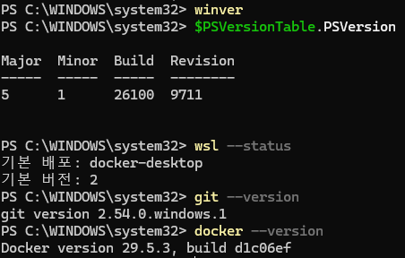

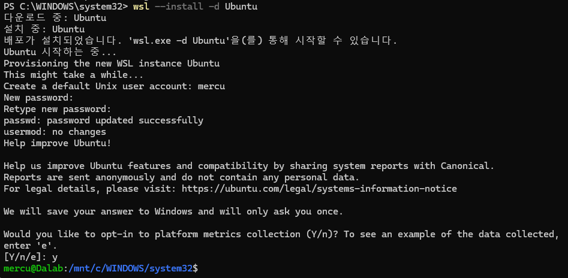

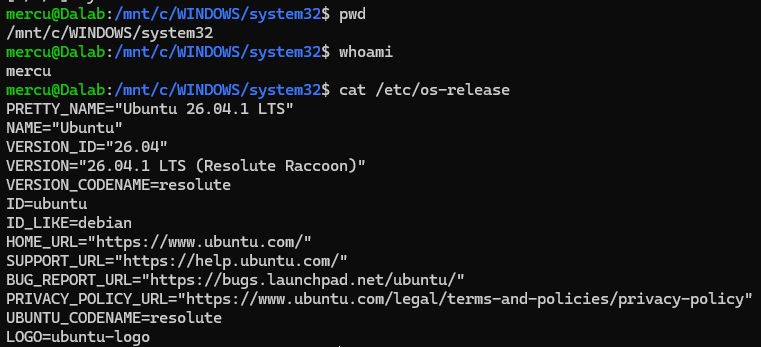

---

## 3. 수행 체크리스트

- [x] Windows 및 WSL2 Ubuntu 환경 확인
- [x] Linux 터미널 기본 명령어 실습
- [x] 절대 경로 및 상대 경로 실습
- [x] 파일 권한 변경
- [x] 디렉터리 권한 변경
- [x] Docker 설치 및 동작 확인
- [x] Docker hello-world 실행
- [x] Ubuntu 컨테이너 실행 및 내부 진입
- [x] Docker 이미지 및 컨테이너 관리
- [x] Docker 로그 및 리소스 확인
- [x] Dockerfile 기반 커스텀 이미지 빌드
- [x] 포트 매핑 및 웹 서버 접속
- [x] 바인드 마운트 변경 반영 확인
- [x] Docker 볼륨 영속성 검증
- [x] Git 설정 및 저장소 초기화
- [x] GitHub 원격 저장소 연결
- [x] GitHub 첫 push 성공
- [x] 트러블슈팅 2건 이상 기록
- [x] VS Code GitHub 연동 및 최종 캡처

---

## 4. 프로젝트 디렉터리 구조

```text
mission1/
├── README.md
├── Dockerfile
├── .gitignore
├── site/
│   └── index.html
├── docs/
│   └── images/
└── practice/
```

각 파일과 디렉터리의 역할은 다음과 같다.

| 경로 | 역할 |
|---|---|
| README.md | 실습 과정 및 결과 기록 |
| Dockerfile | 커스텀 Docker 이미지 생성 |
| .gitignore | Git 추적 제외 파일 설정 |
| site/index.html | NGINX에서 제공할 웹 페이지 |
| docs/images/ | 실습 증거 스크린샷 |
| practice/ | Linux 명령어 및 권한 실습 |

### 프로젝트 생성

```bash
mkdir -p ~/codyssey/mission1
cd ~/codyssey/mission1

mkdir -p site docs/images practice

touch README.md
touch Dockerfile
touch site/index.html

ls -la
```

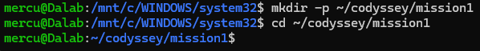

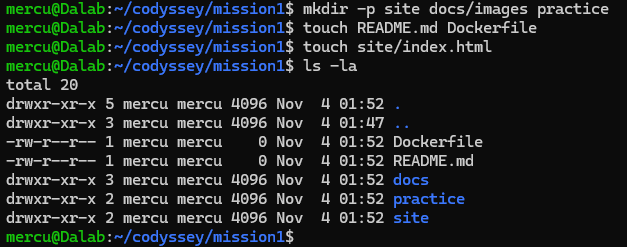

---

## 5. Linux 터미널 기본 명령어 실습

### 5.1 파일 및 디렉터리 관리

```bash
cd ~/codyssey/mission1/practice

pwd
mkdir test_dir
touch empty.txt

echo "hello" > a.txt
cat a.txt

cp a.txt b.txt
mv b.txt test_dir/c.txt

ls -l test_dir
cat test_dir/c.txt

cd test_dir
pwd
cd ..

rm test_dir/c.txt
```

주요 명령어의 의미:

| 명령어 | 기능 |
|---|---|
| pwd | 현재 작업 디렉터리 확인 |
| ls | 파일 및 디렉터리 목록 |
| ls -la | 숨김 파일을 포함한 상세 목록 |
| cd | 디렉터리 이동 |
| mkdir | 디렉터리 생성 |
| touch | 빈 파일 생성 |
| cat | 파일 내용 출력 |
| cp | 파일 복사 |
| mv | 파일 이동 및 이름 변경 |
| rm | 파일 삭제 |
| rmdir | 빈 디렉터리 삭제 |

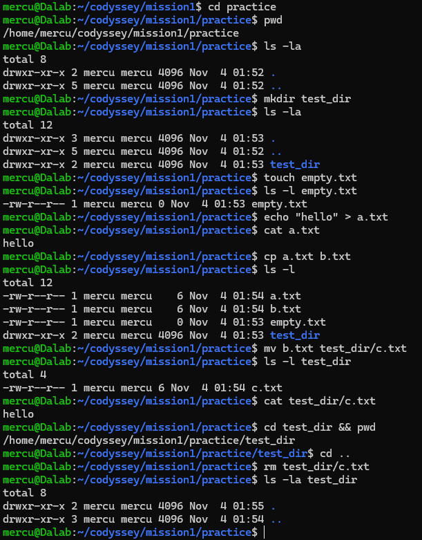

### 5.2 절대 경로와 상대 경로

절대 경로는 `/`부터 시작하는 전체 경로이고, 상대 경로는 현재 작업 디렉터리를 기준으로 한다.

```bash
cd /home/mercu/codyssey/mission1/practice
pwd

cd ..
pwd

cd practice
pwd
```

확인한 경로:

```text
/home/mercu/codyssey/mission1/practice
/home/mercu/codyssey/mission1
/home/mercu/codyssey/mission1/practice
```

- `/` : 루트 디렉터리
- `.` : 현재 디렉터리
- `..` : 상위 디렉터리
- `~` : 사용자 홈 디렉터리

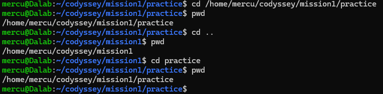

---

## 6. 파일 및 디렉터리 권한 실습

### 6.1 Linux 권한 구조

Linux 파일 권한은 소유자, 그룹, 기타 사용자로 구분된다.

| 기호 | 의미 | 숫자 |
|---|---|---|
| r | 읽기 | 4 |
| w | 쓰기 | 2 |
| x | 실행 | 1 |

대표적인 권한:

| 숫자 | 문자 표현 | 의미 |
|---|---|---|
| 755 | rwxr-xr-x | 소유자는 모든 권한, 나머지는 읽기·실행 |
| 644 | rw-r--r-- | 소유자는 읽기·쓰기, 나머지는 읽기 |
| 700 | rwx------ | 소유자만 접근 가능 |

### 6.2 파일 권한 변경

```bash
cd ~/codyssey/mission1/practice

ls -l a.txt

chmod 755 a.txt
ls -l a.txt

chmod 644 a.txt
ls -l a.txt
```

권한 변경 결과:

```text
변경 전: -rw-r--r-- (644)
변경 후: -rwxr-xr-x (755)
원복 후: -rw-r--r-- (644)
```

`chmod 755`는 소유자에게 실행 권한을 추가한다.

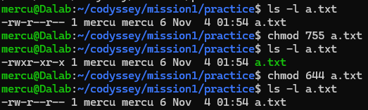

### 6.3 디렉터리 권한 변경

```bash
ls -ld test_dir

chmod 700 test_dir
ls -ld test_dir

chmod 755 test_dir
ls -ld test_dir
```

권한 변경 결과:

```text
변경 전: drwxr-xr-x (755)
변경 후: drwx------ (700)
원복 후: drwxr-xr-x (755)
```

디렉터리의 `x` 권한은 해당 디렉터리 내부로 진입하거나 경로를 탐색하는 데 필요하다.

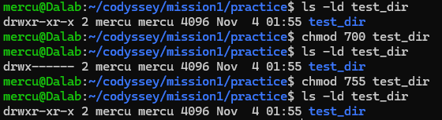

### 6.4 실습 디렉터리 정리

```bash
rmdir test_dir
ls -la
```

`rmdir`은 비어 있는 디렉터리만 삭제할 수 있다.

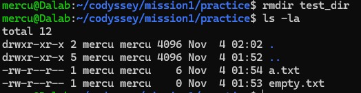

---

## 7. Docker 기본 운영 및 컨테이너 실습

### 7.1 Docker 설치 및 데몬 확인

```bash
docker --version
docker info
```

Docker 버전:

```text
Docker version 29.5.3, build d1c06ef
```

`docker info`에서 Client와 Server 정보가 모두 정상 출력되는지 확인하였다.

초기에는 Docker 소켓 접근 권한 오류가 발생했으며, 해결 과정은 12장 트러블슈팅에 기록하였다.

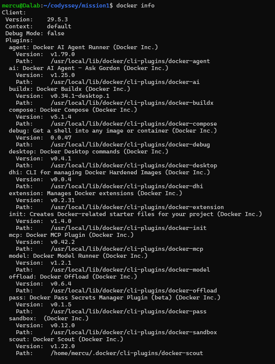

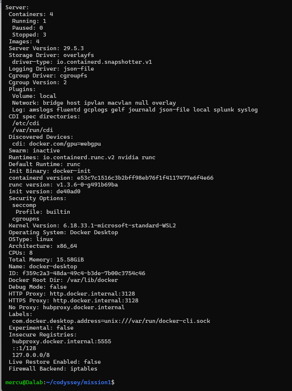

### 7.2 hello-world 실행

```bash
docker run hello-world
```

실행 결과:

```text
Hello from Docker!
This message shows that your installation appears to be working correctly.
```

Docker 이미지 다운로드, 컨테이너 생성 및 실행이 정상적으로 이루어짐을 확인하였다.

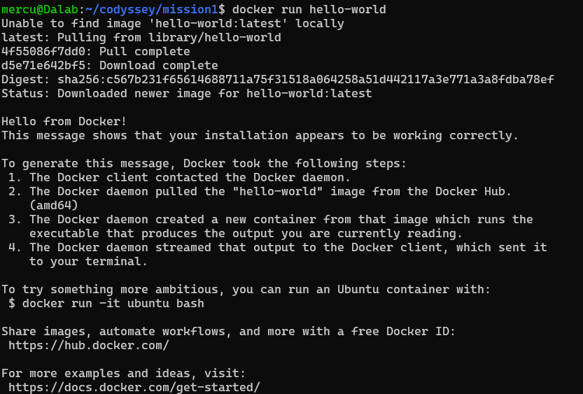

### 7.3 Ubuntu 이미지 다운로드

```bash
docker pull ubuntu
docker images
```

Ubuntu 이미지를 Docker Hub에서 다운로드하고 이미지 목록에 표시되는지 확인하였다.

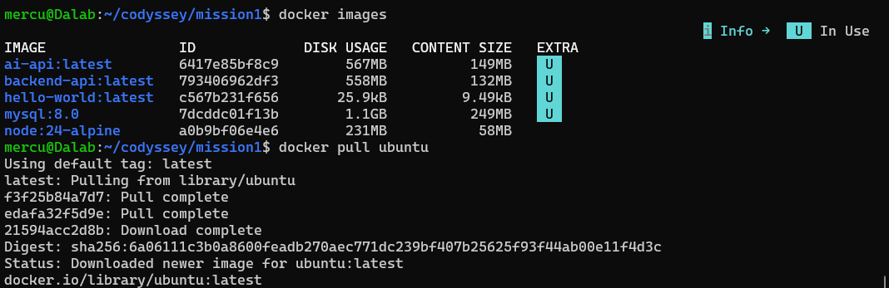

### 7.4 Ubuntu 컨테이너 내부 진입

```bash
docker run -it --name my-ubuntu ubuntu bash
```

컨테이너 내부에서 실행:

```bash
pwd
ls
echo "hi"
exit
```

실행 결과:

```text
/
hi
```

`-it` 옵션으로 대화형 터미널을 실행할 수 있음을 확인하였다.

`exit`으로 메인 셸이 종료되면 컨테이너도 종료된다.

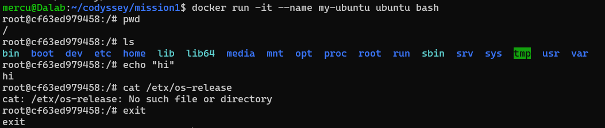

### 7.5 컨테이너 목록 확인

```bash
docker ps
docker ps -a
```

- `docker ps`: 실행 중인 컨테이너 표시
- `docker ps -a`: 종료된 컨테이너까지 모두 표시

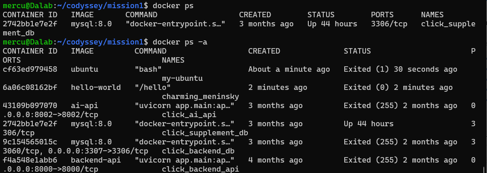

### 7.6 컨테이너 시작, 명령 실행 및 종료

```bash
docker start my-ubuntu
docker ps

docker exec my-ubuntu echo "Docker exec success"

docker stop my-ubuntu
docker ps -a
```

실행 결과:

```text
Docker exec success
```

`docker exec`는 실행 중인 컨테이너에서 별도 명령어를 실행한다.

`docker stop`은 실행 중인 컨테이너를 종료한다.

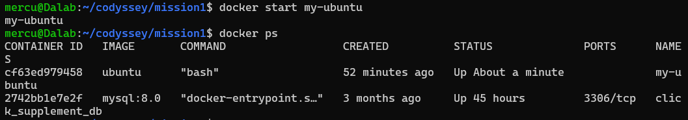

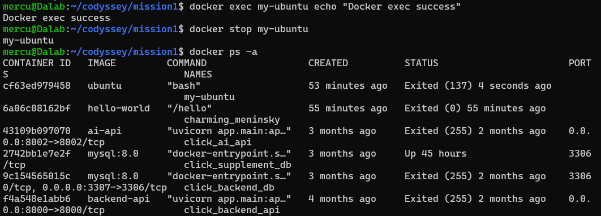

### 7.7 컨테이너 실행 방식 비교

| 방식 | 특징 |
|---|---|
| docker run -it | 새 컨테이너 생성 후 대화형 실행 |
| docker exec | 실행 중인 컨테이너에서 새 명령 실행 |
| docker attach | 실행 중인 컨테이너의 메인 프로세스에 연결 |
| docker stop | 실행 중인 컨테이너 중지 |
| docker start | 중지된 컨테이너 재시작 |

컨테이너는 메인 프로세스가 살아 있는 동안 실행 상태를 유지한다.

### 7.8 Docker 로그 확인

```bash
docker run --name log-test ubuntu echo "Docker log test success"

docker logs log-test
```

실행 결과:

```text
Docker log test success
```

컨테이너가 종료된 뒤에도 `docker logs`로 표준 출력 기록을 확인할 수 있다.

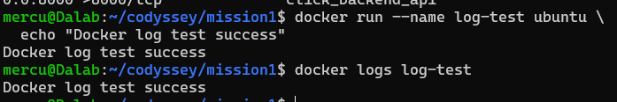

### 7.9 Docker 리소스 확인

```bash
docker stats --no-stream
```

`--no-stream` 옵션을 사용하면 CPU, 메모리, 네트워크 등 리소스 사용량을 한 번만 출력한다.

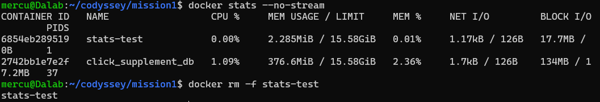

---

## 8. Dockerfile 기반 커스텀 웹 서버

### 8.1 베이스 이미지 선택

웹 서버 베이스 이미지로 `nginx:alpine`을 선택하였다.

선택 이유:

- NGINX 웹 서버가 미리 설치되어 있다.
- Alpine Linux 기반으로 비교적 가볍다.
- 정적 HTML 파일을 복사하는 방식으로 간단하게 웹 서버를 구성할 수 있다.

### 8.2 웹 페이지 작성

`site/index.html` 파일에 웹 페이지를 작성하였다.

최초 작성 내용:

```html
<!DOCTYPE html>
<html lang="ko">
<head>
    <meta charset="UTF-8">
    <title>Codyssey Docker Mission</title>
</head>
<body>
    <h1>Hello Docker!</h1>
    <p>My first custom Docker web server.</p>
    <p>Codyssey Mission 1</p>
</body>
</html>
```

이후 바인드 마운트 실습 과정에서 HTML 내용을 변경하였다.

### 8.3 Dockerfile 작성

```dockerfile
FROM nginx:alpine

LABEL description="Codyssey custom nginx web server"

COPY site/ /usr/share/nginx/html/

EXPOSE 80
```

명령어 설명:

| 명령어 | 의미 |
|---|---|
| FROM | 베이스 이미지 지정 |
| LABEL | 이미지 메타데이터 설정 |
| COPY | 호스트 파일을 이미지 내부로 복사 |
| EXPOSE | 컨테이너가 사용하는 포트 문서화 |

`EXPOSE`만으로 호스트 포트가 연결되지는 않으며, 실제 연결에는 `docker run -p`가 필요하다.

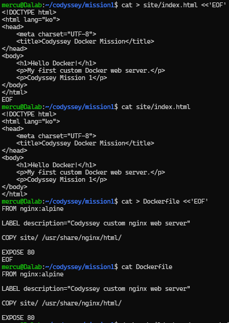

### 8.4 커스텀 이미지 빌드

```bash
cd ~/codyssey/mission1

docker build -t codyssey-web:1.0 .
```

이미지 확인:

```bash
docker images
```

`codyssey-web:1.0` 이미지가 생성되었음을 확인하였다.

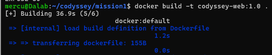

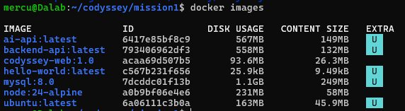

### 8.5 포트 매핑: 8080

```bash
docker run -d \
  --name codyssey-web-8080 \
  -p 8080:80 \
  codyssey-web:1.0
```

접속 확인:

```bash
docker ps
curl http://localhost:8080
```

웹 브라우저에서도 다음 주소로 접속하였다.

http://localhost:8080

최초 빌드한 이미지의 웹 페이지에서 `Hello Docker!`가 표시되는 것을 확인하였다.

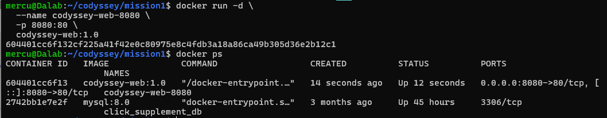

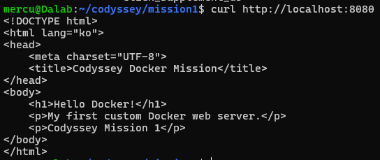

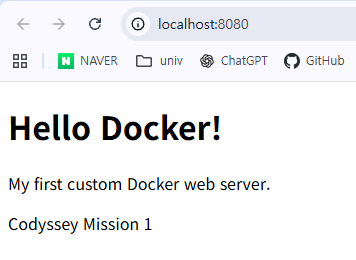

### 8.6 포트 매핑: 8081

동일한 이미지를 사용하여 두 번째 컨테이너를 실행하였다.

```bash
docker run -d \
  --name codyssey-web-8081 \
  -p 8081:80 \
  codyssey-web:1.0
```

접속 확인:

```bash
curl http://localhost:8081
```

브라우저 주소:

http://localhost:8081

두 컨테이너는 모두 내부 80 포트를 사용하지만, 호스트 포트를 각각 8080과 8081로 지정하여 동시에 실행할 수 있었다.

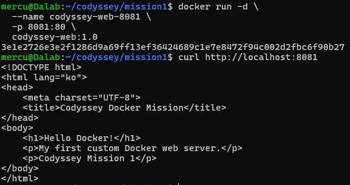

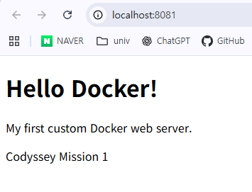

### 8.7 포트 매핑의 필요성

Docker 컨테이너는 격리된 네트워크 환경에서 실행된다.

`-p 8080:80`은 호스트의 8080 포트를 컨테이너의 80 포트로 연결한다.

따라서 호스트 브라우저나 `curl`에서 컨테이너 웹 서버에 접근할 수 있다.

---

## 9. Docker 바인드 마운트 실습

### 9.1 바인드 마운트 실행

호스트의 `site/` 디렉터리를 컨테이너의 NGINX 웹 루트에 연결하였다.

```bash
cd ~/codyssey/mission1

docker run -d \
  --name codyssey-bind \
  -p 8082:80 \
  -v "$(pwd)/site:/usr/share/nginx/html:ro" \
  nginx:alpine
```

옵션 설명:

- `$(pwd)/site`: 현재 프로젝트의 HTML 디렉터리
- `/usr/share/nginx/html`: 컨테이너 내부 웹 루트
- `:ro`: 컨테이너에서 읽기 전용으로 연결

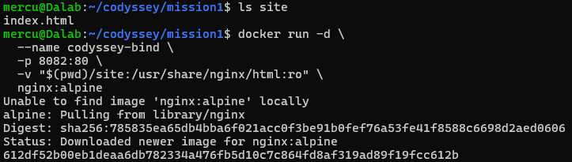

### 9.2 변경 전 웹 페이지 확인

브라우저에서 다음 주소로 접속하였다.

http://localhost:8082

변경 전에는 기존 `Hello Docker!` 페이지가 표시되었다.

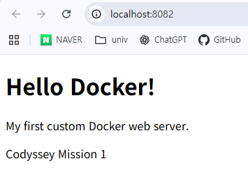

### 9.3 호스트 HTML 수정

호스트의 `site/index.html` 파일을 다음과 같이 수정하였다.

```html
<!DOCTYPE html>
<html lang="ko">
<head>
    <meta charset="UTF-8">
    <title>Bind Mount Test</title>
</head>
<body>
    <h1>Bind Mount Success!</h1>
    <p>HTML file updated without rebuilding Docker image.</p>
    <p>Codyssey Mission 1 - Bind Mount Test</p>
</body>
</html>
```

접속 확인:

```bash
curl http://localhost:8082
```

변경 후 출력에서 다음 문구를 확인하였다.

```html
<h1>Bind Mount Success!</h1>
```

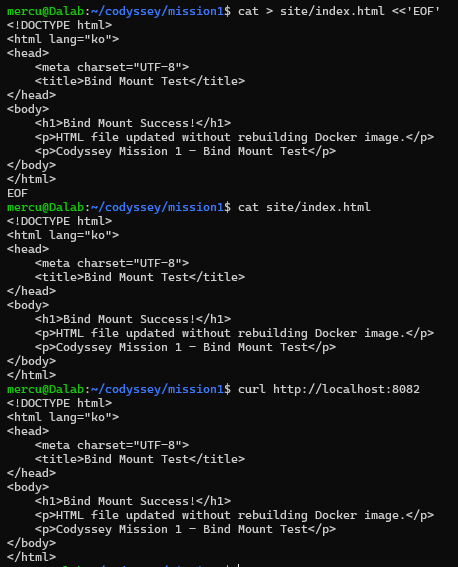

### 9.4 변경 후 브라우저 확인

이미지를 다시 빌드하거나 컨테이너를 재시작하지 않고 브라우저를 새로고침하였다.

변경한 HTML 내용이 즉시 표시되었다.

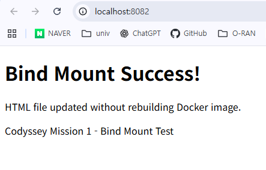

**실습 결과:** 바인드 마운트는 호스트 디렉터리를 직접 연결하므로 파일 변경이 컨테이너에 즉시 반영된다.

---

## 10. Docker 볼륨 영속성 실습

### 10.1 볼륨 생성

```bash
docker volume create codyssey-data
docker volume ls
```

생성 결과:

```text
codyssey-data
```

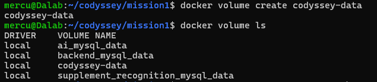

### 10.2 볼륨에 데이터 저장

```bash
docker run --name volume-test1 \
  -v codyssey-data:/data \
  ubuntu \
  sh -c 'echo "Docker Volume Persistence Success!" > /data/test.txt'
```

`codyssey-data` 볼륨을 컨테이너의 `/data`에 연결하여 텍스트 파일을 저장하였다.

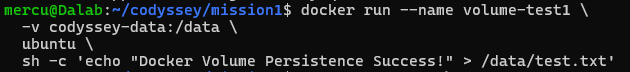

### 10.3 데이터 확인 및 기존 컨테이너 삭제

```bash
docker run --rm \
  -v codyssey-data:/data \
  ubuntu cat /data/test.txt
```

실행 결과:

```text
Docker Volume Persistence Success!
```

기존 컨테이너 삭제:

```bash
docker rm volume-test1
docker ps -a
```

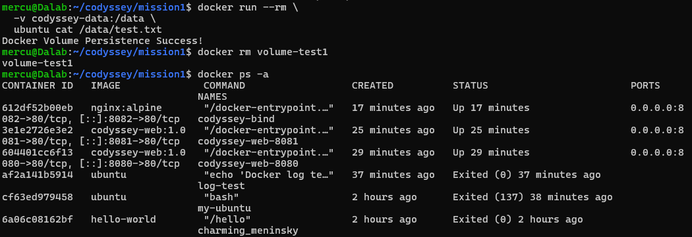

### 10.4 새 컨테이너에서 데이터 확인

```bash
docker run --name volume-test2 \
  -v codyssey-data:/data \
  ubuntu cat /data/test.txt
```

실행 결과:

```text
Docker Volume Persistence Success!
```

볼륨 정보 확인:

```bash
docker volume inspect codyssey-data
```

볼륨 이름과 마운트 경로가 정상 출력되었다.

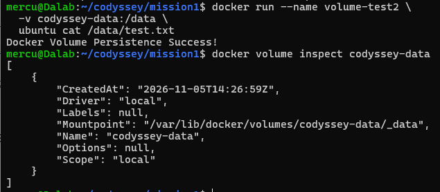

**실습 결과:** 기존 컨테이너를 삭제한 뒤에도 동일한 볼륨을 연결한 새 컨테이너에서 데이터가 유지됨을 확인하였다.

### 10.5 바인드 마운트와 Docker 볼륨 비교

| 구분 | 바인드 마운트 | Docker 볼륨 |
|---|---|---|
| 저장 위치 | 사용자가 지정한 호스트 경로 | Docker가 관리하는 저장소 |
| 연결 방식 | 호스트 경로 지정 | 볼륨 이름 지정 |
| 주요 목적 | 소스 코드 및 설정 파일 공유 | 영속 데이터 저장 |
| 변경 반영 | 호스트 파일 수정 즉시 반영 | 동일 볼륨을 연결한 컨테이너 간 데이터 공유 |
| 실습 결과 | HTML 변경 즉시 확인 | 컨테이너 삭제 후 데이터 유지 |

---

## 11. Git 및 GitHub 연동

### 11.1 Git 사용자 정보 설정

Git 커밋 작성자 정보와 기본 브랜치를 설정하였다.

```bash
git config --global user.name "Kang-min Han"
git config --global user.email "본인 이메일"
git config --global init.defaultBranch main
```

설정 확인:

```bash
git config --list
```

Git 작성자 이름은 커밋 기록에 사용되며, GitHub 로그인 아이디와는 다르다.

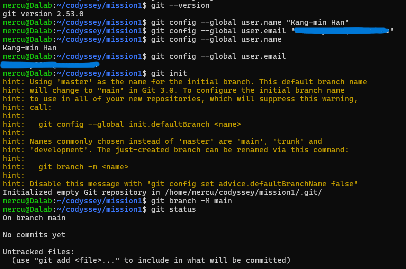

### 11.2 Git 저장소 초기화

```bash
cd ~/codyssey/mission1

git init
git branch -M main
git status
```

초기 상태:

```text
On branch main

No commits yet
```

Git은 로컬 파일의 변경 이력을 관리하고, GitHub는 Git 저장소를 원격으로 보관하고 공유하는 서비스이다.

### 11.3 Git 파일 등록

```bash
git add .
git status
```

등록된 파일에는 다음 항목이 포함되었다.

```text
.gitignore
Dockerfile
README.md
docs/images/
site/index.html
```

`git add .`는 현재 디렉터리의 변경 파일을 Git 스테이징 영역에 등록한다.

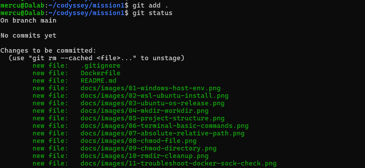

### 11.4 GitHub 저장소 연결 및 첫 push

GitHub에 Public 저장소를 생성하였다.

**저장소 주소:** https://github.com/mercury0925/mission1

원격 저장소 연결:

```bash
git remote add origin https://github.com/mercury0925/mission1.git
git remote -v
```

커밋 및 업로드:

```bash
git commit -m "Mission 1: dev workstation setup"
git push -u origin main
```

첫 푸시 과정에서 GitHub HTTPS 인증 문제가 발생하여 GitHub CLI를 이용해 해결하였다.

인증 후 다시 푸시한 결과:

```text
To https://github.com/mercury0925/mission1.git
 * [new branch] main -> main
branch 'main' set up to track 'origin/main'.
```

로컬 `main` 브랜치가 원격 저장소의 `main` 브랜치에 정상 업로드되었다.

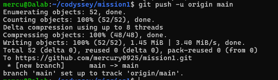

### 11.5 VS Code GitHub 연동

**진행 상태: 완료**

VS Code의 Microsoft WSL 확장 프로그램을 설치하고 Ubuntu 프로젝트를 열었다.

```bash
cd ~/codyssey/mission1
code .
```

VS Code에서 다음 사항을 확인하였다.

- WSL: Ubuntu 환경으로 연결됨
- 프로젝트 경로: `/home/mercu/codyssey/mission1`
- Source Control에서 Git 저장소 인식
- 현재 브랜치: `main`
- 수정된 `README.md` 및 새 이미지 파일 확인
- GitHub 원격 저장소에 연결된 `main` 브랜치 확인

이를 통해 VS Code에서 WSL 기반 Git 프로젝트를 관리할 수 있음을 확인하였다.

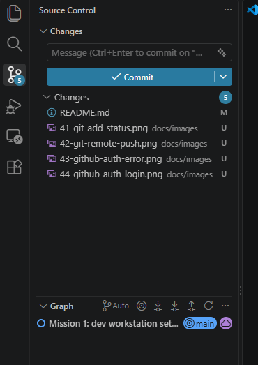

---

## 12. 트러블슈팅

### 12.1 Docker 소켓 접근 권한 오류

**문제**

Ubuntu에서 `docker info`를 실행했을 때 Docker Server 정보 대신 다음 오류가 발생하였다.

```text
permission denied while trying to connect to the Docker API at unix:///var/run/docker.sock
```

**원인 분석**

Docker 클라이언트는 `/var/run/docker.sock`을 통해 Docker 데몬과 통신한다.

해당 소켓의 접근 권한을 확인하였다.

```bash
whoami
groups
ls -l /var/run/docker.sock
```

확인 결과:

```text
사용자: mercu
소켓 소유자 및 그룹: root docker
소켓 권한: srw-rw----
```

현재 사용자가 `docker` 그룹에 속하지 않아 소켓 접근 권한이 없었다.

**해결 과정**

```bash
sudo usermod -aG docker mercu
newgrp docker

groups
docker info
```

`docker` 그룹에 사용자를 추가하고 변경된 그룹 권한을 적용하였다.

**해결 결과**

`docker info`에서 Client와 Server 정보가 정상 출력되었다.

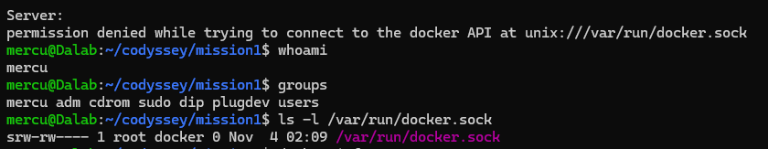

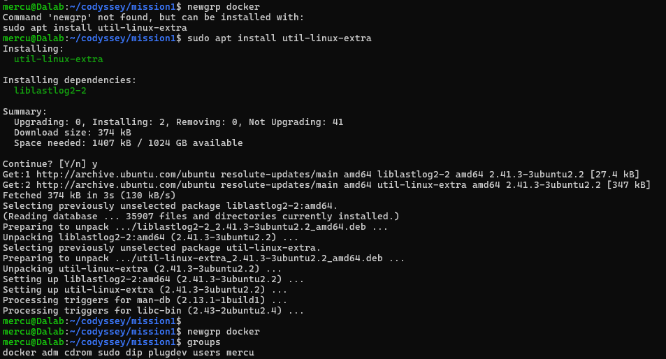

**배운 점**

- Docker CLI와 데몬은 소켓을 통해 통신한다.
- Linux 그룹 권한에 따라 Docker 사용 가능 여부가 달라질 수 있다.
- `docker` 그룹은 높은 시스템 권한을 부여하므로 신뢰할 수 있는 사용자에게만 적용해야 한다.
- 보안을 위해 Docker 소켓 권한을 무조건 `666`으로 변경하지 않았다.

### 12.2 GitHub HTTPS 인증 및 GitHub CLI 설치 문제

**문제**

GitHub 원격 저장소에 업로드하기 위해 다음 명령어를 실행하였다.

```bash
git push -u origin main
```

그러나 GitHub 사용자 이름과 비밀번호를 요청받았다.

```text
Username for 'https://github.com': Kang-min Han
Password for 'https://Kang-min%20Han@github.com':
```

Git 커밋 작성자 이름인 `Kang-min Han`을 GitHub 로그인 사용자 이름으로 잘못 입력하였다.

이후 GitHub CLI를 이용하려고 했으나 설치되어 있지 않았다.

```text
Command 'gh' not found, but can be installed with:
sudo apt install gh
```

**원인 분석**

- Git 커밋 작성자 이름과 GitHub 계정 아이디를 혼동하였다.
- 실제 GitHub 아이디는 `mercury0925`이다.
- GitHub HTTPS 인증에는 일반 계정 비밀번호를 사용할 수 없다.
- Ubuntu에 GitHub CLI가 설치되어 있지 않았다.

**해결 과정 1: GitHub CLI 설치**

```bash
sudo apt install gh
```

설치 과정에서 sudo 비밀번호 입력이 한 차례 실패하였으나, 다시 입력하여 정상적으로 설치하였다.

설치 확인:

```bash
gh --version
```

출력:

```text
gh version 2.46.0 (2025-12-13 Ubuntu 2.46.0-4)
```

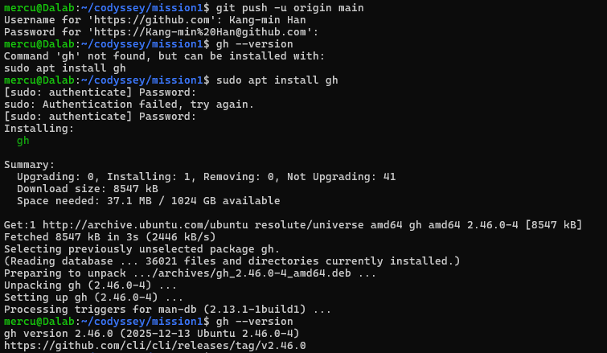

**해결 과정 2: 브라우저 인증**

```bash
gh auth login
```

다음 항목을 선택하였다.

```text
GitHub.com
HTTPS
Authenticate Git with your GitHub credentials? Yes
Login with a web browser
```

WSL 환경에서 브라우저 자동 실행을 시도했지만 다음 오류가 발생하였다.

```text
Failed opening a web browser at https://github.com/login/device
exec: "xdg-open,x-www-browser,www-browser,wslview": executable file not found in $PATH
```

브라우저가 자동으로 실행되지 않아 Windows 브라우저에서 GitHub 인증 페이지를 직접 열고 인증을 완료하였다.

인증 확인:

```bash
gh auth status
```

확인 결과:

```text
Logged in to github.com account mercury0925
Active account: true
Git operations protocol: https
```

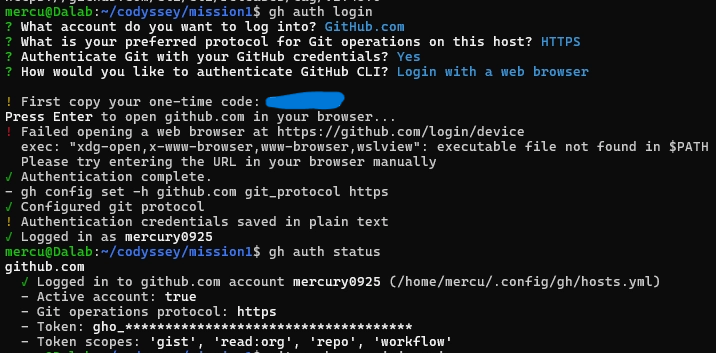

**해결 과정 3: GitHub에 다시 push**

```bash
git push -u origin main
```

성공 결과:

```text
To https://github.com/mercury0925/mission1.git
 * [new branch] main -> main
branch 'main' set up to track 'origin/main'.
```

**해결 결과**

GitHub CLI 브라우저 인증을 완료하고 로컬 프로젝트를 GitHub 원격 저장소에 정상적으로 업로드하였다.

**배운 점**

- Git 작성자 이름과 GitHub 로그인 아이디는 서로 다르다.
- GitHub HTTPS 인증에는 일반 비밀번호 대신 토큰 또는 인증 도구가 필요하다.
- GitHub CLI로 브라우저 인증을 진행할 수 있다.
- WSL에서 브라우저 자동 실행에 실패하더라도 인증 페이지를 직접 열어 해결할 수 있다.
- `git push` 결과를 통해 원격 저장소 업로드 성공 여부를 확인할 수 있다.

### 12.3 newgrp 명령어 미설치 문제

**문제**

Docker 그룹 권한을 적용하기 위해 `newgrp docker`를 실행했으나 명령어를 찾을 수 없었다.

```text
Command 'newgrp' not found, but can be installed with:
sudo apt install util-linux-extra
```

**원인 분석**

Ubuntu 환경에 `newgrp` 명령어를 제공하는 패키지가 설치되지 않았다.

**해결 과정**

```bash
sudo apt install util-linux-extra
newgrp docker
groups
```

설치 후 `newgrp docker`를 실행하여 그룹 변경을 적용하였다.

**해결 결과**

`groups` 명령어에서 `docker` 그룹이 표시되었고 Docker 명령어가 정상 실행되었다.

**배운 점**

Linux에서 필요한 명령어가 기본 설치에 포함되지 않을 수 있으며, 오류 메시지에 표시된 패키지 정보를 이용하여 해결할 수 있다.

---

## 13. 재현 방법 및 주의사항

### 13.1 저장소 다운로드

다른 환경에서 프로젝트를 내려받으려면 다음 명령어를 사용한다.

```bash
git clone https://github.com/mercury0925/mission1.git
cd mission1
```

이미 프로젝트가 존재하는 현재 Ubuntu 환경에서는 다시 실행할 필요가 없다.

### 13.2 Docker 이미지 빌드

```bash
docker build -t codyssey-web:1.0 .
```

### 13.3 웹 서버 실행

```bash
docker run -d \
  --name codyssey-web-8080 \
  -p 8080:80 \
  codyssey-web:1.0
```

### 13.4 접속 확인

```bash
curl http://localhost:8080
```

브라우저:

http://localhost:8080

### 13.5 주의사항

- WSL 홈 디렉터리에서 실습하는 것을 권장한다.
- Docker Desktop의 WSL Integration이 활성화되어 있어야 한다.
- Docker 사용 권한이 없다면 사용자 그룹을 확인해야 한다.
- 8080 포트가 이미 사용 중이면 다른 호스트 포트를 지정해야 한다.
- 동일한 컨테이너 이름이 이미 존재하면 이름 충돌이 발생할 수 있다.
- 바인드 마운트 명령어는 프로젝트 루트에서 실행해야 한다.
- 실습 환경에 따라 Docker 및 Git 버전이 다를 수 있다.

---

## 14. 보안 및 개인정보 보호

GitHub 저장소는 Public으로 생성하였으므로 업로드되는 파일과 스크린샷을 누구나 볼 수 있다.

따라서 다음 사항을 확인하였다.

- GitHub 인증 토큰과 비밀번호를 README에 기록하지 않는다.
- 인증 코드는 공개 이미지에 노출하지 않도록 가린다.
- 개인정보가 포함된 스크린샷은 업로드 전에 확인한다.
- `.gitignore`를 사용하여 불필요한 파일을 추적하지 않는다.
- Docker 소켓 권한을 무분별하게 변경하지 않는다.

---

## 15. 결론

이번 실습을 통해 Windows 11과 WSL2 Ubuntu를 이용하여 Linux 기반 개발 환경을 구축하였다.

Linux 터미널에서 파일과 디렉터리를 관리하고 권한을 변경하는 방법을 익혔으며, Docker 이미지와 컨테이너의 차이를 직접 확인하였다.

Dockerfile을 작성하여 NGINX 기반 웹 서버 이미지를 만들고, 포트 매핑으로 여러 컨테이너에 접속하였다.

또한 바인드 마운트로 호스트 파일 변경이 즉시 반영되는 것을 확인하고, Docker 볼륨을 통해 컨테이너 삭제 후에도 데이터가 유지되는 것을 검증하였다.

Git과 GitHub를 이용해 프로젝트 파일을 버전 관리하고 원격 저장소에 업로드하였다.

실습 중 발생한 Docker 권한 문제와 GitHub 인증 문제를 분석하고 해결하면서 개발 환경에서 발생할 수 있는 오류를 직접 다루는 경험을 얻었다.

VS Code의 WSL 확장 프로그램을 통해 Ubuntu 프로젝트를 열고 Git 저장소 및 main 브랜치를 확인하여 개발 환경 구축 실습을 완료하였다.
